## 🔓 Open Source:
🐞 I trace bugs in the tools I use down to the root cause, then fix them upstream. 
✅ **Merged into NestJS core by its creator.** A controller and a service in one module got two different instances of the same provider. [nestjs/nest#17141](https://github.com/nestjs/nest/pull/17141) 
✅ **Shipped in Ghostty and Limux** (Zig, Rust). With Num Lock off, keypad keys lost their identity; fixed across three PRs. [ghostty#1](https://github.com/bvolpato/ghostty/pull/1) · [limux#199](https://github.com/am-will/limux/pull/199) · [limux#204](https://github.com/am-will/limux/pull/204) 
✅ **Landed in Vercel Labs scriptc v0.4.0** as a co-authored commit, so Zod-style schemas compile to native code. [0f50a7b](https://github.com/vercel-labs/scriptc/commit/0f50a7be57ebb0efa1e745a291b268714b1ec3cf) 
🔗 [See each fix with its root cause, diff and maintainer review →](https://droppage.dev/p/Mnl17XTS8e) 

## 🧩 Client Work:

🏷️ **[deepmarks](https://droppage.dev/p/HHA0YreRYp)**: an AI naming agent for startups. One sentence in, ranked names out, with domains checked and buyable in place. LangGraph agents in Python behind a gRPC stream, six writers at once, a critic, brand stories, Stripe and Name.com, OpenTelemetry. [deepmarks.ai](https://deepmarks.ai) 
🔒 More client work (marketplaces, field service, video platforms) lives in private repos; case studies follow as clients approve them. 

# 💫 About Me:
💻 Freelance full-stack engineer, **TypeScript end to end**: Node.js and NestJS APIs, React and Next.js web apps, React Native and Expo mobile apps. 
🚀 I ship client products from the first commit to production: payments, marketplaces, AI agents, video platforms and field-service apps. 
🔌 Integrations I've built: Stripe, Hostaway, IBM Maximo, KNET, ElevenLabs, Speechmatics, self-hosted Jitsi, OpenRouter LLMs over gRPC. 
🤝 Open to new client work. [Hire me on Upwork →](https://www.upwork.com/freelancers/~015acda9682670c3cc?mp_source=share) 

## 🛠️ Things I Built:
📄 **[droppage](https://droppage.dev)**: publish an HTML file as a live, access-controlled page in one command, with hosted images and video. [CLI](https://github.com/Vilancer/droppage-cli) 
🤖 **[bugbit](https://github.com/Vilancer/bugbit)**: a self-hosted GitHub Action that reviews your PRs with your own Cursor agent. 
🔗 **[filelinks](https://github.com/Vilancer/filelinks)**: declare semantic links between files, so an agent, git hook or editor knows what to check when something changes. 
✏️ **[jitsi-scribble](https://github.com/Vilancer/jitsi-scribble)**: a FaceTime-style "draw on the shared screen" overlay for `@jitsi/react-native-sdk`. 

## 🌐 Socials:
 
  

# 💻 Tech Stack:
 
 
 
 
 
 
 
 
 
 
 
 
 
 
 
 
 
 
 
 
 
 

---

<picture>
  <source media="(prefers-color-scheme: dark)" srcset="https://raw.githubusercontent.com/malekelkssas/malekelkssas/output/snake-dark.svg">
  <source media="(prefers-color-scheme: light)" srcset="https://raw.githubusercontent.com/malekelkssas/malekelkssas/output/snake-light.svg">
  
</picture>
